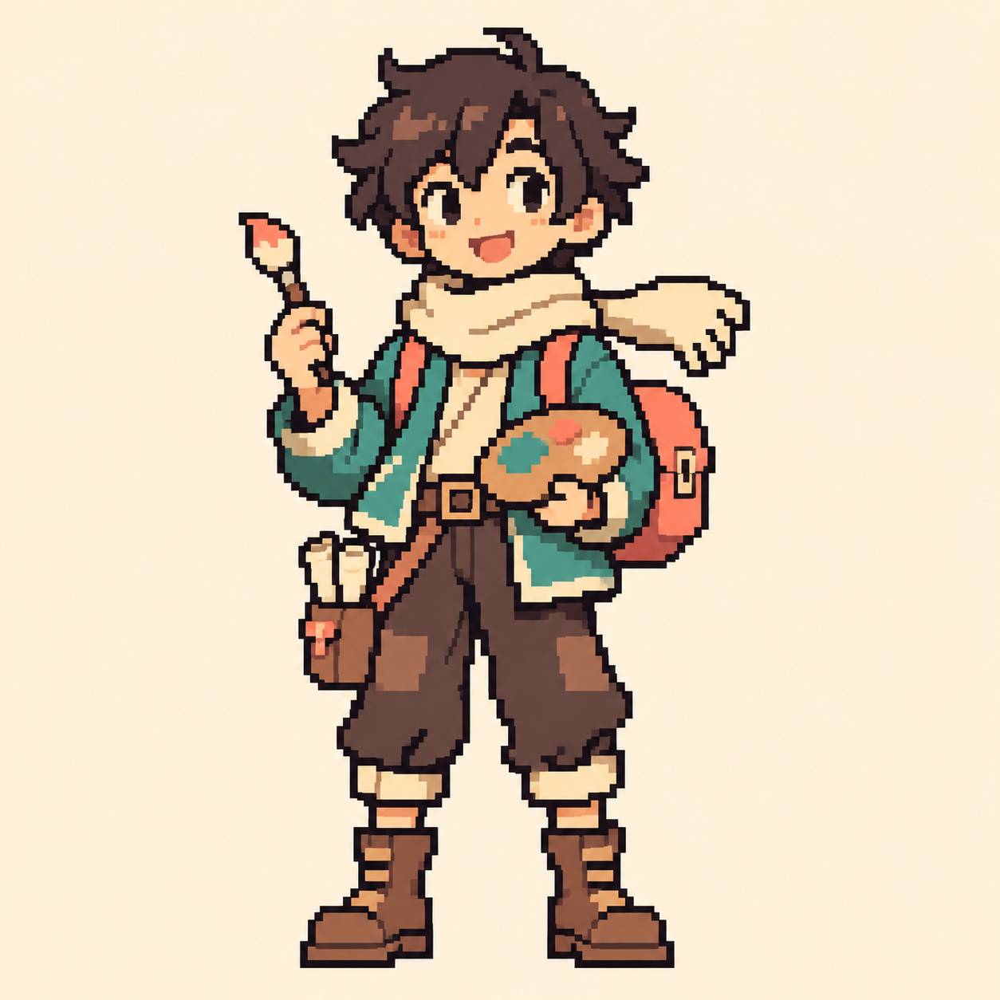
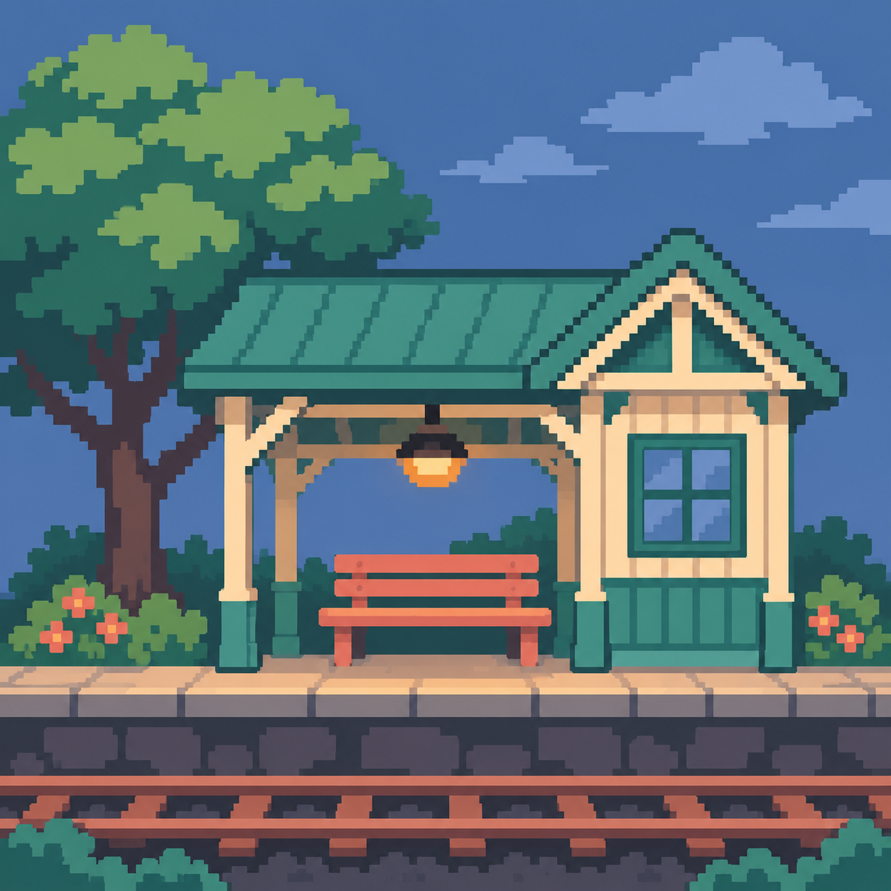
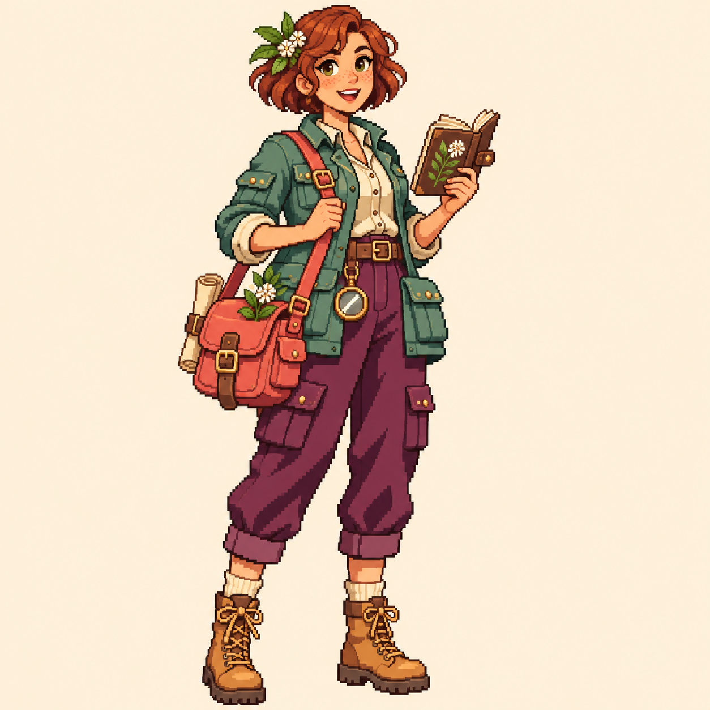
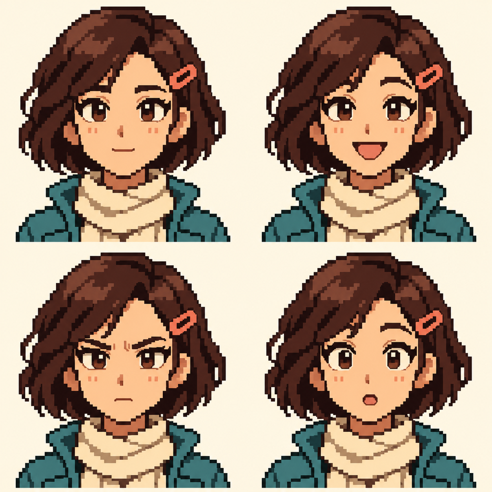
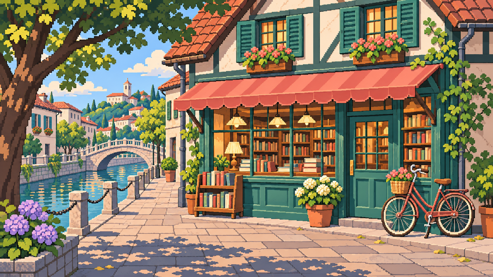

# Pixel Style Examples

Visual references for [pixel-style.md](../../references/pixel-style.md), supported
by [six worked production briefs](../../references/pixel-examples.md). New work
uses a minimum of 128×128 logical pixels per asset or sheet drawing cell. Prefer
256×256 for a detailed character and 512×288 for a wide environment. Logical-grid
intent is different from the dimensions of a generated reference PNG.

These examples demonstrate rendering and composition, not approved recurring
characters or story locations. Use the guide as production acceptance criteria;
not every generated detail is a technical standard to copy.

## Gallery and design intent

| Example | Logical design target | What to study |
| --- | --- | --- |
| [Original character](character-example.png) | 128×128 for one figure | Basic silhouette, stepped contour, costume colors and simple expression. |
| [Original environment](environment-example.png) | 128×128 initial compact study | Shape hierarchy and readable architecture. New square environment work now starts at 256×256. |
| [Detailed character](character-detailed-example.png) | 256×256 for one figure | More room for face/hands, layered clothing, notebook contact and distinct materials. |
| [Expression sheet](expression-sheet-example.png) | 128×128 per cell, 2×2 / 256×256 total before gutters | Same facial construction and hair across four expressions; do not allocate 128 pixels to the whole sheet. |
| [Wide environment](environment-wide-example.png) | 512×288, 16:9 | Foreground/middle/background, richer architecture, controlled detail and light. |

All logical targets above come from the generation briefs and remain unverified
as native grids. A larger saved file does not establish that its design contains
more logical detail or an exact integer scale.

## 1. Original character — compact 128 target

A friendly artist/adventurer with dark hair, teal jacket, cream scarf, coral
backpack and painting tools. Study the silhouette, stepped edges and color grouping.
For new detailed character work, prefer the 256 target below.

## 2. Original environment — compact study

A cozy train platform with teal/cream shelter, coral bench and warm lamp. This
initial 128-target study is retained for comparison. Use 256×256 or 512×288 when
more location/architectural detail is needed; a small study is not the new default.

## 3. Detailed character — 256 target

An original botanical explorer with auburn hair, sage-teal jacket, cream shirt,
plum trousers, tan boots, coral satchel and a field notebook. Compare face/hand
readability, clothing layers, strap/buckle construction and pixel cluster density
with the compact character above. They are different designs, not versions of
the same character or a controlled resolution-only comparison.

## 4. Expressions — minimum 128 per face cell

A 2×2 study of neutral, happy, focused and surprised expressions for one original
character. Look for stable head scale, hairstyle, eyes, clip side and collar;
change expressions through brows, eyes and mouth. In production, compare each cell
against an approved identity image and record any drift.

## 5. Wide environment — 512×288 target

A canal-side bookshop in afternoon light, with teal/cream architecture, coral
awning, a bicycle, walkway, canal and bridge. Study the focal point, spatial
layers, perspective and discrete material shading instead of adding uniform noise.

## Generation and technical status

Generated with the built-in image generation tool for this repository on
2026-11-25. The complete [generation prompts](prompts.md) are retained. These are
visual references, not certified native-grid sprites, tileable textures, indexed
palettes or animation sheets. Opaque backgrounds are intentional.

Measured saved-file metadata (all PNG, without alpha):

| File | Actual export dimensions |
| --- | --- |
| `character-example.png` | 1254×1254 |
| `environment-example.png` | 1254×1254 |
| `character-detailed-example.png` | 1254×1254 |
| `expression-sheet-example.png` | 1254×1254 |
| `environment-wide-example.png` | 1672×941, approximately 16:9 |

Visual review confirmed the new character's full-body costume/material details,
four distinct expressions with repeated hair/clip/collar, and the wide scene's
bookshop/canal/foreground layout. The focused face reads stern; generated shade
variation and fine texture remain. The detailed character has tight top/bottom
padding. These are examples to critique, not assets marked fully production-ready.
Do not infer exact color counts, native-grid alignment, per-cell source size, or
nearest-neighbor scaling from their appearance or saved dimensions.

For strict production, verify actual native dimensions, sheet cell rectangles,
integer scale, palette, alpha, crop and frame continuity using the source/export.
Use the [acceptance checklist](../../references/pixel-style.md#acceptance-checklist)
and disclose unverified checks. Do not claim that a generation prompt proves them.

Original smooth illustration references: [basic-style](../basic-style/README.md).
